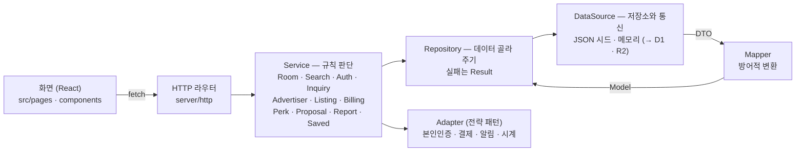

# 품 Poom — 한부모 가족 쉐어하우스

> **한부모 가족 전용 방 광고판 — 가족은 0원, 계약은 광고한 분과 직접.**
> 아이와 함께 살 곳이 급한 한부모 가족과 공인중개사 · 집주인을 이어 주는 웹앱 (한국어 · English)
> Poom /puːm/ — 한국어 "품"(두 팔로 안아 주는 곳)

---

## 1. 기획 — 왜 만드나

| 문제 | Poom의 해결 |
|---|---|
| 일반 쉐어하우스는 1인 청년 전용 — 아이와 들어갈 수 없음 | **한부모 + 자녀(만 24세 이하) 전용** 하우스, 엄마 하우스 · 아빠 하우스 분리 |
| 공공임대 · 복지시설은 서류가 많고 공고 · 심사까지 몇 달 | **서류 1장**을 서류함에 한 번 올리고 여러 집에 문의, 광고한 분이 바로 연락 |
| 집 찾기 사이트에 아이 · 가족 조건이 없음 | 한부모 가족을 받는 방만 모아 보여 주고, 가족 수에 맞는 방만 문의 |
| 가족이 크면 맞는 집 찾기가 더 어려움 | 공공 기준(**최저주거기준**)으로 가족 수 · 자녀 나이에 맞는 방만 보여 줌 |
| 한국에 사는 외국인 한부모는 한국어 서류 · 사이트가 벽 | **한국어 · 영어** 전체 지원, 외국인등록증으로 신청 |

- **목표 지표 (North Star):** 월간 "계약함" 문의 수 · 광고 1개당 한부모 문의 수
- **수익 구조:** 품은 광고판 + 문의 전달 도구 (공인중개사 자격 불필요) — 집주인 광고비 · 공인중개사 구독 · 상단 노출 · 문의당 과금 · 제휴 수수료 · 기관 연계 · 기업 후원. 모두 계약 성사와 무관한 고정 금액, 한부모 가족은 0원 ([Business Model](docs/Proposal/planner_Monetization.md))
- 기획 원본: [`docs/Proposal/common_Index.md`](docs/Proposal/common_Index.md) (브리프 · 요구사항 · 정책 · 화면 · 데이터 · 운영 · 법무 17개 문서)

## 2. 주요 기능

| 기능 | 내용 | 기획 ID |
|---|---|---|
| 🔍 3칸 검색 | **어디로**(지역 · 역 · 학교 · 어린이집, 초성 · 영문) · **언제부터** · **누구와**(우리 가족) | `REQ_030` |
| 👨‍👧 가족 맞춤 방 | 6세 이상 자녀는 부모와 분리, 8세 이상 남매 분리 → 필요한 침실 수 · 면적 이상만 | `POL_ROOM` · `REQ_024` |
| 🗺 지도 | 동 단위 묶음만 (정확한 주소는 광고한 분이 직접) | `POL_SEARCH_01` |
| ⚙ 필터 | 보증금 · 월 비용 · 바로 입주 · 계단 없음 · 전용 욕실 · 놀이방 · 학교 근처 · 영어 상담 … | `REQ_033` |
| 📮 문의하기 | 3단계 + **내 상황 자세히 · 급한 정도** + 광고한 분에게 보내는 **동의**, 같은 방 1번 · 동시에 5곳 | `REQ_053` · `POL_INQUIRY` |
| 📄 서류함 · 진행 표시 | 서류 1장 한 번 올리고 보낼 곳 고르기, 운영 매니저 확인 배지. 보냄 → 연락 옴 → 집 보기 → 계약함 (서류 안 보내면 계약함 불가 `DOC_428`) | `REQ_054` · `055` · `POL_HOUSE_02` |
| 📣 광고 올리기 | 공인중개사(등록번호) · 집주인(소유 서류) 등록 → 광고 확인 → 30일 광고비 · 월 구독 · ⭐ 상단 노출 · 문의당 과금 정산, 받은 문의 관리 | `REQ_049` ~ `052` · `POL_AD` |
| 🎁 혜택 | 제휴 할인 · 기업 후원 · 기관 지원 (가족 0원, 업체 · 기업 · 기관이 냄) | `REQ_056` · `POL_PERK` |
| ✉️ 문의 | 광고 · 제휴 · 후원 · 기관 연계 제안 받기 | `REQ_057` · `POL_PROPOSAL` |
| ♡ 관심 · 🔔 빈방 알림 | 관심 방, 검색 조건 저장, 0건 지역은 **지역 수요**로 집계(다음 하우스 위치) | `REQ_035` · `036` |
| 💬 의견 · 신고함 | 모든 화면: 종류 6개 + 화면 사진 + **최근 3분 기록** → 운영 콘솔에서 상태 · 심각도 · 처리 기록 | `REQ_025` ~ `029` |
| 📢 공지 | 서비스 · 하우스 · 혜택 공지, 📌 중요 공지는 맨 위 + 홈 화면 띠(최대 3개), 운영 콘솔에서 쓰기 · 고치기 · 내림 | `REQ_046` ~ `048` |
| 🙋 커뮤니티 | 묻고 답하기 — 읽기는 누구나, 쓰기는 본인인증, 실명 대신 "엄마 · 아빠 + 4글자", 연락처 자동 가림, 신고 3명 자동 숨김, 운영팀 공식 답변 | `REQ_041` ~ `044` |
| 🆘 긴급 도움 | 112 · 1366 · 129 · 1345(다국어) 바로 걸기 | `REQ_010` |
| 🛠 운영 콘솔 | 광고주 · 광고 확인 · 서류 확인 · 문의 통계(기관 보고용) · 매출 · 혜택 · 제안 문의 · 신고함 · 공지 · 커뮤니티 · 지역 수요 (`/admin`) | `D09-ADMIN` · `REQ_058` |
| 🌐 한국어 · English | `/` ↔ `/en`, 문구 키 100% 일치 테스트 | `POL_LANG` |

화면은 휴대폰 세로 · 가로, 폴더블 겉화면(280px), 태블릿, PC 비율마다 따로 맞췄습니다. 버튼 글은 줄바꿈되어 밖으로 나가지 않고, 아래 고정 버튼은 탭바 · 홈 바 위에 항상 보입니다.

## 3. 아키텍처

개념편(Java vs C# · C# 아키텍처)의 계층 · Result · DI 원칙을 TypeScript 로 적용했습니다.



| 원칙 | 적용 |
|---|---|
| 계층 분리 | 화면 → Service → Repository → DataSource 순서로만 부름 |
| DTO ≠ Model | `server/dtos` (snake_case, 모두 선택값) → `server/mappers` → `server/models` (readonly) |
| Result 패턴 | 데이터 실패(`NotFound` · `Storage`)는 Repository, 규칙 실패(`RoomTooSmall` · `DocumentRequired` …)는 Service |
| DI | `server/container.ts` 한 곳에서만 `new`, Mock ↔ Real 은 여기서 바꿔 끼움 |
| 도메인 단위 Service | 화면 이름이 아니라 `RoomService` · `ContractService` · `ReportService` |
| 테스트 | Given-When-Then, 시계 · 아이디 고정 Mock (F.I.R.S.T) |

```
server/  core · models · dtos · mappers · dataSources · repositories · services · adapters · rules · http · app.ts
src/     api(DTO · 클라이언트) · state · i18n · lib(3분 기록 · 형식) · components · pages · styles
functions/api/[[path]].ts   Cloudflare Pages Functions 입구 (server/app.ts 호출)
data/ · schema/             시드 데이터 JSON + JSON Schema
docs/Proposal/              기획서 (배포되지 않음)
openspec/                   기능 명세 (OpenSpec)
```

## 4. 기술 스택

| 영역 | 사용 |
|---|---|
| 화면 | React 19 · React Router 7 · TypeScript · Vite 7 · PWA(manifest) |
| 지도 | Leaflet + OpenStreetMap (국내 지도 API는 F-18에서 결정) |
| 서버 | Cloudflare Pages Functions (개발 때는 Vite 미들웨어가 같은 `server/app.ts` 실행) |
| 저장 | Mock: 메모리 + JSON 시드 / Real: Cloudflare D1 · R2 (예정) |
| 테스트 | Vitest · Ajv(JSON Schema) |
| 명세 | OpenSpec (`/opsx:propose` → `/opsx:apply` → `/opsx:archive`) |

### 실행

```bash
npm install
npm run dev        # http://localhost:5173 (화면 + API)
npm test           # 단위 · API 테스트
npm run build      # dist/ (앱 파일만)
```

- 운영 콘솔: `/admin` — 테스트판 키 `poom-admin-dev`
- 배포: `npm run deploy:test` (테스트판, `dev` 브랜치) · `npm run deploy:prod` (운영판, `main`에서만 · 대표 승인 후)

## 5. 현재 상태 (2026-11-27)

| 항목 | 상태 |
|---|---|
| 단계 | **P1 설계 ~ P2 개발 (Mock 모드 MVP)** — 사업 검토(P0) 결정 대기 항목 있음 |
| 동작 | 광고주 등록 → 운영 콘솔 확인 → 광고 결제(Mock) · 게시 · ⭐ 상단 노출 → 가족 검색 → 문의 → 서류함 · 서류 보내기 → 광고주 진행 옮기기 → 계약함 → 문의 과금 정산, 혜택 신청 · 제안 문의 · 신고함까지 **끝까지 동작** |
| 테스트 | 단위 · API 테스트 97개 통과 (`npm test`), 화면 비율 9종 버튼 넘침 검사 |
| 데이터 | 예시 광고 3곳 · 방 9개 · 예시 혜택 4개 (**예시 데이터**, 실제 매물 아님) |
| 외부 연동 | 본인인증 · 결제 · 문자 · 지도 업체 모두 **Mock** — 실제 개인정보 · 결제 없음 |
| 배포 | 아직 없음 (Cloudflare 로그인 필요) |

## 6. 보완 순서

| 순서 | 할 일 | 관련 |
|---|---|---|
| 1 | **사업자 형태 · 광고 가격 · 문의 과금 법률 확인** | F-02 · F-21 · F-23 |
| 1-1 | 출시 지역 공인중개사 · 집주인 광고 100개 확보 (무료 체험) | F-03 |
| 2 | 테스트판 배포 (Cloudflare Pages `dev`) + 지인 테스터 신고 받기 | `REQ_028` |
| 3 | Real 모드: D1(광고 · 문의 · 결제 기록 · 신고) · R2(서류함 · 사진, 보관 기간 F-22) 연결 | D07-TECH |
| 4 | 본인인증 · PG(광고 상품 · 정기결제) · 문자 업체 선정 · 연동, 중개사무소 등록번호 조회 | F-09 · F-11 |
| 5 | 국내 지도 API · 학교 · 어린이집 공공데이터 연결 | F-18 · F-19 |
| 6 | 이용약관 · 개인정보처리방침(한 · 영) · 사업자 정보 표시 · 법무 검토 | D13-LEGAL |
| 7 | 운영 콘솔 로그인(Cloudflare Access + 2단계), 감사 로그 | D09-ADMIN |
| 8 | v1.0: 제휴 업체 · 후원 기업 · 기관 연계 계약 / v1.1: 공공 공고 알림 · 공인중개사 앱 연동 | `REQ_056` · `057` |

전체 정할 것 · 위험 목록: [`docs/Proposal/common_needFix.md`](docs/Proposal/common_needFix.md)
