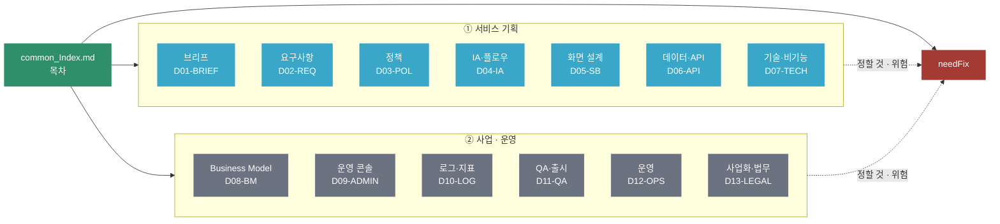

# Poom (품) — 기획서 목차

> 문서 세트: **목차** · 기획: [브리프](owner_Brief.md) · [요구사항](planner_Requirements.md) · [정책](planner_Policy.md) · [IA·플로우](planner_IA_Flow.md) · [화면 설계](designer_Storyboard.md) · [데이터·API](developer_Data_API.md) · [기술·비기능](developer_Tech_NFR.md) · 사업·운영: [Business Model](planner_Monetization.md) · [운영 콘솔](planner_Admin.md) · [로그·지표](planner_Analytics.md) · [QA·출시](tester_Release.md) · [운영](operator_Operations.md) · [사업화·법무](owner_Legal.md) · [needFix](common_needFix.md)
> **분류:** 웹 (PWA) — 한부모 + 자녀 전용 쉐어룸 · **언어:** 한국어 · English · **스택:** React + Vite · Cloudflare Pages · Workers · D1 · R2 — 서류 1장으로 신청하고, 적은 보증금으로, 빈방이면 빠르면 당일 아이와 입주하는 쉐어룸

> **문서 정보**

| 문서 번호 | 버전 | 상태 | 책임자 | 협업 | 최종 수정 | 관련 문서 |
|---|---|---|---|---|---|---|
| `D00-INDEX` | v0.1 | `Draft` | PM | — | 2026-11-26 | — |

**변경 이력**

| 버전 | 날짜 | 변경 내용 | 사유 | 결정자 | 영향 범위 |
|---|---|---|---|---|---|
| v0.1 | 2026-11-26 | 첫 초안 | 서비스 기획 시작 | PM | 전체 |

---

## 서비스 한 줄
**"서류 걱정 없이 오늘 신청하고, 보증금 조금으로 이번 주에 아이와 들어가는 한부모 전용 쉐어룸."**

| 기둥 | 내용 | 릴리즈 |
|---|---|---|
| ⓢ 검색 · 지도 | 검색창(지역 · 역 · 학교 · 어린이집) · 지도(동 단위) · 필터 · 관심 방 · 빈방 알림 · 지역 수요 | MVP |
| ① 방 찾기 · 바로 입주 | 방 목록 → 상세 → 본인인증 → 3단계 신청 + 서류 1장 사진 (등본 또는 한부모가족 증명서) → 2시간 안 상담 통화 · 서류 확인 → 전자계약 · 결제 → 당일 입주 · 한국어 / English | MVP |
| ② Poom 생활 | 월세 자동 납부 · 하우스 공지 · 수리 요청 | v1.0 |
| ⓘ 의견 · 신고함 | 모든 화면 신고 버튼 → 운영 콘솔 신고함(접수 → 확인 → 처리 중 → 완료) → 주간 분류로 개선 방향 | MVP |
| ③ 함께 키우기 | 돌봄 품앗이 · 물품 나눔 · 공공임대 공고 알림 | v1.1 |

## 문서 구성
- 파일 이름 = `직무 접두사_문서명.md`. 접두사는 해당 문서 **책임자의 직무**. 전 직무 공용 문서는 `common_`.
- 상태 `Draft` = 아직 정해지지 않은 계획(초안), `Review` = 검토 중, `Confirmed` = 구현 대상.
- 고칠 점 · 정할 것은 모두 **[needFix](common_needFix.md)**.
- 이 폴더는 **무엇을 · 왜**(기획), `openspec/`은 기능별 **동작 명세**(WHEN/THEN), [CLAUDE.md](../../CLAUDE.md)는 개발 규칙임.
- 공통 관리: [용어집](common_Glossary.md)(`D00-TERM`) · [결정 로그](common_Decisions.md)(`D00-DEC`)

**직무 접두사**

| 접두사 | 직무 | 책임 범위 |
|---|---|---|
| `owner_` | 대표 | 사업 방향 · 예산 · 법무 · 하우스 확보 · 최종 승인 |
| `planner_` | PM | 요구사항 · 정책 · 화면 흐름 · 운영 콘솔 · Business Model · 지표 |
| `designer_` | UI 디자이너 | 화면 설계 · 문구 · 방 사진 촬영 기준 |
| `developer_` | 개발 리드 · 프론트엔드 개발자 · 백엔드 개발자 | 기술 구조 · 구현 · 데이터 · 보안 |
| `tester_` | QA 테스터 | 테스트 케이스 · 출시 판정 |
| `operator_` | 운영 매니저 | 입주 상담 · 하우스 관리 · 고객 대응 · 위기 대응 |
| `common_` | (책임자: PM) | 공용 관리 문서 |

**번호 찾는 곳**

| 번호 모양 | 뜻 | 정해진 문서 |
|---|---|---|
| `REQ_###` | 요구사항 | [planner_Requirements.md](planner_Requirements.md) |
| `POL_…` | 정책 규칙 | [planner_Policy.md](planner_Policy.md) |
| `SCR_…` | 화면 | [planner_IA_Flow.md](planner_IA_Flow.md) |
| `API_…` · 에러 코드 | API | [developer_Data_API.md](developer_Data_API.md) |
| `PRD_…` | 방 상품 | [planner_Monetization.md](planner_Monetization.md) |
| `evt_…` | 로그 이벤트 | [planner_Analytics.md](planner_Analytics.md) |
| `TC_###` | 테스트 케이스 | [tester_Release.md](tester_Release.md) |
| `F-##` · `W-##` | 정할 것 · 위험 | [common_needFix.md](common_needFix.md) |

**[구성도] 문서 지도**

| 문서 | 문서 번호 | 단계 | 상태 | 책임자 | 협업 |
|---|---|---|---|---|---|
| [브리프](owner_Brief.md) | `D01-BRIEF` | P0 | `Draft` | 대표 | PM |
| [요구사항](planner_Requirements.md) | `D02-REQ` | P1 ~ | `Draft` | PM | 개발 리드 |
| [정책](planner_Policy.md) | `D03-POL` | P1 | `Draft` | PM | 대표 · 백엔드 개발자 |
| [IA·플로우](planner_IA_Flow.md) | `D04-IA` | P1 | `Draft` | PM | UI 디자이너 · 프론트엔드 개발자 |
| [화면 설계](designer_Storyboard.md) | `D05-SB` | P1 | `Draft` | UI 디자이너 | PM · 프론트엔드 개발자 |
| [데이터·API](developer_Data_API.md) | `D06-API` | P1 | `Draft` | 백엔드 개발자 | PM · 프론트엔드 개발자 |
| [기술·비기능](developer_Tech_NFR.md) | `D07-TECH` | P1 | `Draft` | 개발 리드 | 백엔드 개발자 · 대표 |
| [Business Model](planner_Monetization.md) | `D08-BM` | P1 | `Draft` | PM | 대표 |
| [운영 콘솔](planner_Admin.md) | `D09-ADMIN` | P2 | `Draft` | PM | 백엔드 개발자 · 운영 매니저 |
| [로그·지표](planner_Analytics.md) | `D10-LOG` | P2 | `Draft` | PM | 프론트엔드 · 백엔드 개발자 |
| [QA·출시](tester_Release.md) | `D11-QA` | P2 ~ P3 | `Draft` | QA 테스터 | 개발자 |
| [운영](operator_Operations.md) | `D12-OPS` | P3 ~ P4 | `Draft` | 운영 매니저 | PM |
| [사업화·법무](owner_Legal.md) | `D13-LEGAL` | P0 ~ P3 | `Draft` | 대표 | PM |
| [needFix](common_needFix.md) | `D00-FIX` | — | `Review` | PM | 전 직무 |

> 지금 위치: **P2 개발 — Mock 모드 MVP 동작** (검색 → 신청 → 서류 확인 → 계약 → 결제 → 입주 안내, 신고함 · 운영 콘솔). 사업 검토(P0)의 1호점 확보 방식 · 사업자 형태는 결정 전

**그림 규칙** — 흐름도는 위 → 아래, 색은 초록 = 시작 · 파랑 = 처리 · 빨강 = 값 변경 · 주황 마름모 = 판단 · 보라 = 출력 · 회색 = 끝. 구성도는 왼쪽 → 오른쪽.

## 단계별 Gate
| 단계 | 확인 항목 | 현재 |
|---|---|---|
| P0 → P1 | [브리프](owner_Brief.md) 승인, 예산 · 일정이 자금 범위 안 | ❌ `Draft` |
|  | 수익 모델 · 1호점 확보 방식 결정 | ❌ [F-02](common_needFix.md#2-정할-것), [F-03](common_needFix.md#2-정할-것) |
|  | [사업화·법무](owner_Legal.md) 항목 목록 | ✅ 목록 있음 |
| P1 → P2 | 모든 Must에 담당 · 공수 · 완료 기준 | 🔶 공수는 추정치 |
|  | 핵심 문서 `Confirmed` | ❌ |
|  | 요구사항 ↔ 화면 ↔ API ↔ 정책 ID 연결 | 🔶 초안 연결 |
| P2 → P3 | 모든 Must 구현 · 운영 콘솔로 신청 → 입주 처리 · 로그 수집 · 테스트 결제 | ❌ |
| P3 → 출시 | 치명 버그 0 · 약관 · 처리방침 · 사업자 정보 · 1호점 보험 · [사업화·법무](owner_Legal.md) 완료 | ❌ |
