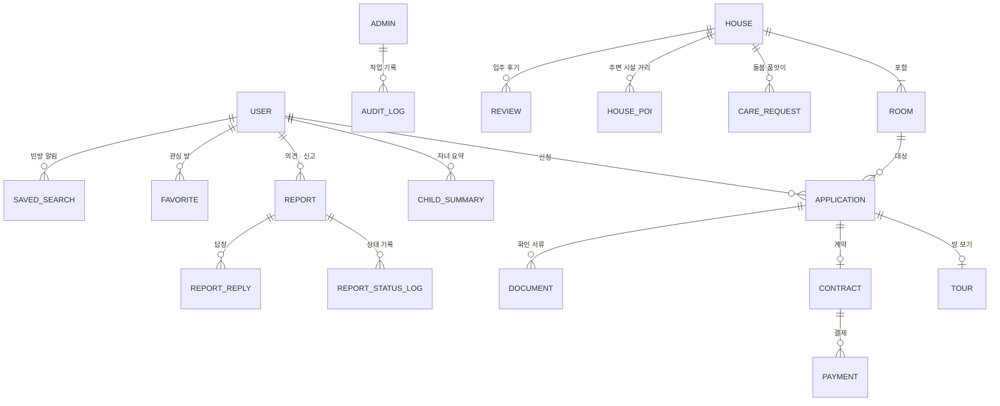

# 데이터 · API — Poom (품)

> 문서 세트: [목차](common_Index.md) · 기획: [브리프](owner_Brief.md) · [요구사항](planner_Requirements.md) · [정책](planner_Policy.md) · [IA·플로우](planner_IA_Flow.md) · [화면 설계](designer_Storyboard.md) · **데이터·API** · [기술·비기능](developer_Tech_NFR.md) · 사업·운영: [Business Model](planner_Monetization.md) · [운영 콘솔](planner_Admin.md) · [로그·지표](planner_Analytics.md) · [QA·출시](tester_Release.md) · [운영](operator_Operations.md) · [사업화·법무](owner_Legal.md) · [needFix](common_needFix.md)

> **문서 정보**

| 문서 번호 | 버전 | 상태 | 책임자 | 협업 | 최종 수정 | 관련 문서 |
|---|---|---|---|---|---|---|
| `D06-API` | v0.7 | `Draft` | 백엔드 개발자 | PM · 프론트엔드 개발자 | 2026-11-26 | [화면 설계](designer_Storyboard.md) · [정책](planner_Policy.md) |

**변경 이력**

| 버전 | 날짜 | 변경 내용 | 사유 | 결정자 | 영향 범위 |
|---|---|---|---|---|---|
| v0.7 | 2026-11-27 | 검색 · 지도 · 관심 방 · 빈방 알림 · 지역 수요 · 주변 시설 · 후기 · 제휴 문의, `HOUSE` 속성 · 방 목록 필터 | 원하는 지역 · 학교 · 직장 근처로 방을 찾게 함 | 백엔드 개발자 | DB · API · 데이터 파일 |
| v0.6 | 2026-11-26 | `REPORT` · 상태 기록 · 답장, `API_REPORT_01` ~ `03`, `REPORT_413` · `429` | 민원 · 오류를 끝까지 처리하고 개선 방향을 정하기 위함 | 백엔드 개발자 | DB · API · R2 |
| v0.5 | 2026-11-26 | `ROOM` 침실 수 · 면적 · 상품, 방 목록 가족 조건, `ROOM_422`, 나이대 6 · 8세 경계 | `POL_ROOM` | 백엔드 개발자 | DB · 방 API · 신청 API |
| v0.5 | 2026-11-27 | `USER.minor_parent`, `AUTH_403`에서 나이 조건 뺌 | `POL_MEMBER_01` · `POL_MEMBER_05` | 백엔드 개발자 | DB · 본인인증 API |
| v0.4 | 2026-11-26 | `age_band`에 `13-18` · `19-24`, 계약 동거인 | `POL_HOUSE_01` · `POL_HOUSE_07` | 백엔드 개발자 | DB · 신청 API |
| v0.3 | 2026-11-26 | `DOCUMENT`를 신청에 연결, `API_DOC_01` 경로 · `DOC_428` 추가 | `POL_HOUSE_02` 입주 전 제출 | 백엔드 개발자 | DB · 계약 API |
| v0.2 | 2026-11-26 | `USER.lang` · `id_type` · `verify_status`, 서류 종류, 다국어 데이터 · 문구 파일 | `POL_LANG` · `POL_MEMBER_04` · `POL_HOUSE_06` | 백엔드 개발자 | DB · API · 문자 |
| v0.1 | 2026-11-26 | 첫 초안 | 서비스 기획 시작 | 백엔드 개발자 | 전체 |

---

## 1. 목적
화면 데이터의 저장 구조와 클라이언트 ↔ 서버 주고받는 형식. 설정 · 콘텐츠 데이터 원본은 **JSON + JSON Schema**.

## 2. 개념 ERD

| 엔티티 | 주요 컬럼 | 개인정보 |
|---|---|---|
| `USER` | id, name, phone, ci_hash, gender, lang(`ko`/`en`), id_type(`kr`/`alien`), verify_status(`verified`/`need_check`), stay_until, created_at, status | name · phone **암호화**, ci는 해시만 · 콘솔 기본 마스킹 |
| `CHILD_SUMMARY` | user_id, age_band(`0-5`/`6-7`/`8-12`/`13-18`/`19-24`), gender | 이름 · 생일 없음 (`POL_PRIVACY_01`) |
| `HOUSE` | id, name, type(`mom`/`dad`), gu, dong, dong_center(lat · lng, 동 중심점), lat, lng(비공개), building_type, elevator(bool), playroom(bool), parking(bool), foreigner_ok(bool), english_staff(bool), move_out_cleaning_fee, min_months, address, entry_info, rules_json(`{ko, en}`) | address · entry_info는 **입주자에게만** |
| `ROOM` | id, house_id, product(`PRD_ROOM_1`~`4`), bedrooms, private_m2, shared_m2_share, private_bath(bool), max_household, deposit, rent, fee, available_from, status(`vacant`/`held`/`occupied`) | — |
| `APPLICATION` | id, user_id, room_id, move_in_date, months, contact_time, memo, status, safety_flag | memo **암호화**, safety_flag는 콘솔 `CS` 이상만 |
| `TOUR` | application_id, type(`visit`/`video`), at, status | — |
| `CONTRACT` | id, application_id, start, end, deposit, rent, cohabitants(성인 자녀 수), signed_at, pdf_key, status | pdf는 R2 암호화 |
| `PAYMENT` | id, contract_id, kind(`deposit`/`rent`/`fee`), amount, pg_tx_id, status | 카드 정보 저장 안 함 (PG 빌링키만) |
| `DOCUMENT` | id, application_id, doc_type(`resident_reg`/`single_parent`/`alien_reg`), file_key, checked_at, result, purge_at | 확인 후 30일 파기 (`POL_PRIVACY_04`) |
| `CARE_REQUEST` | id, house_id, from_user, to_user, at, status | 같은 하우스만 조회 |
| `REPORT` | id, user_id(없을 수 있음), house_id, kind(`bug`/`usability`/`house`/`payment`/`safety`/`idea`), message, voice(bool), screen_id, shot_key(R2), trail_json(최근 3분), env_json(화면 · 브라우저 · 터치), channel(`test`/`prod`), version, lang, status, severity(`치명`/`높음`/`보통`/`낮음`), priority(`P1`~`P3`), assignee, duplicate_of, created_at | 이름 · 전화번호 없음. 사진 R2 비공개, 완료 1년 후 사진 · 기록 삭제 (`POL_REPORT_09`) |
| `REPORT_STATUS_LOG` | report_id, from, to, by, at, note | 처리 일수 계산 |
| `REPORT_REPLY` | report_id, by, message_ko, message_en, at, resolution(`원인` · `고친 것` · `확인 방법`) | — |
| `FAVORITE` | user_id, room_id, created_at | — |
| `SAVED_SEARCH` | id, user_id, query_json(지역 · 필터 · 우리 가족), notify(bool), last_notified_at, expires_at(90일) | 지역 수준 조건만 |
| `DEMAND_STAT` | date, gu, dong, household_size, price_band, count | 0건 검색 · 지역 알림 집계 (개인 정보 없음, `POL_SEARCH_04`) |
| `HOUSE_POI` | house_id, kind(`school_e`/`school_m`/`school_h`/`daycare`/`station`/`pediatric`/`mart`), name_ko, name_en, walk_min(5분 단위) | 실제 좌표는 `HOUSE` 비공개 |
| `REVIEW` | id, house_id, user_id, body, status(`waiting`/`public`/`hidden`), created_at | 공개 시 작성자 표시 없음 |
| `PARTNER_INQUIRY` | id, kind(`owner`/`building`/`org`), gu, building_type, rooms, contact, message, status | contact **암호화** |
| `AUDIT_LOG` | admin_id, action, target, reason, at | 삭제 불가 |

## 3. API
| ID | 기능 | Method · 경로 | 요청 | 응답 |
|---|---|---|---|---|
| `API_ROOM_01` | 방 목록 | `GET /api/rooms` | q(지역 · 역 · 학교 ID), gu, type, max_deposit, max_monthly, max_fee, move_in, months, building_type, no_stairs, private_bath, playroom, poi(kind · max_walk_min), foreigner_ok, english_staff, parking, now(bool), children, sort, cursor, limit | items, next_cursor — children가 있으면 필요 침실 수 · 면적 이상만 |
| `API_ROOM_02` | 방 상세 | `GET /api/rooms/:id` | — | room + house(동 단위, 주소 제외) |
| `API_AUTH_01` | 본인인증 시작 · 완료 | `POST /api/auth/verify` | 인증 업체 토큰 | session |
| `API_AUTH_02` | 문자 코드 로그인 | `POST /api/auth/otp` | phone, code | session |
| `API_APPLY_01` | 신청 제출 | `POST /api/applications` | room_id, move_in_date, months, children[], contact_time, memo | id, status |
| `API_APPLY_02` | 내 신청 | `GET /api/me/applications` | — | items[] |
| `API_TOUR_01` | 방 보기 예약 | `POST /api/applications/:id/tour` | type, at | tour |
| `API_CONTRACT_01` | 계약서 조회 · 서명 | `GET` · `POST /api/contracts/:id/sign` | signature | status |
| `API_PAY_01` | 결제 준비 · 승인 | `POST /api/payments` · PG 웹훅 `/api/pg/webhook` | contract_id, kind | 결제창 정보 / status |
| `API_MOVEIN_01` | 입주 안내 | `GET /api/me/movein` | — | address, entry_info, rules |
| `API_DOC_01` | 확인 서류 올리기 (신청 때 · 계약 전) | `POST /api/applications/:id/documents` | doc_type, file | id, status(`checking`) |
| `API_REPORT_01` | 의견 · 신고 보내기 | `POST /api/report` | kind, message, shot(선택, ≤700KB), trail, env, screen_id, channel, version, lang | id |
| `API_REPORT_02` | 신고함 (운영 콘솔) | `GET` · `PATCH /api/admin/reports` | 거르기: kind · status · severity · house · channel · 기간 / 바꾸기: status · severity · priority · assignee · duplicate_of | items[], next_cursor |
| `API_REPORT_03` | 내 신고 · 답장 | `GET /api/me/reports` · `POST /api/me/reports/:id/confirm` | resolved(bool) | items[] |
| `API_SEARCH_01` | 검색 추천 | `GET /api/search/suggest` | q, lang | groups[]: area · station · school · daycare · house (id · 이름 · 종류) |
| `API_ROOM_04` | 지도 묶음 | `GET /api/rooms/map` | bounds, 필터 · children[] | clusters[]: dong · center · min_monthly · vacant_count |
| `API_SAVED_01` | 관심 방 · 빈방 알림 | `POST` · `DELETE /api/me/favorites` · `/api/me/saved-searches` | room_id / query_json, notify | id |
| `API_DEMAND_01` | 지역 알림 (0건 검색) | `POST /api/demand` | gu, dong, household_size, price_band | ok |
| `API_GUIDE_01` | 후기 · 자주 묻는 질문 | `GET /api/reviews` · `/api/faq` | house_id, lang | items[] |
| `API_PARTNER_01` | 집 빌려주기 문의 | `POST /api/partner` | kind, gu, building_type, rooms, contact, message | id |
| `API_NOTICE_01` | 공공 공고 | `GET /api/notices` | region, cursor | items[] |

## 4. 에러 코드
- 모든 API는 `Accept-Language`(`ko` / `en`)를 받아 방 설명 · 규칙 · 에러 문구를 그 언어로 내려줌. 문자 발송은 `USER.lang` 기준.

| 코드 | 의미 | 화면 처리 |
|---|---|---|
| `AUTH_401` | 로그인 만료 | 문자 코드 재로그인 → 원래 화면 |
| `AUTH_403` | 본인인증 실패 · 권한 없음 (부모 나이로는 막지 않음) | "본인인증을 다시 해 주세요" |
| `APPLY_409` | 진행 중 신청 있음 | `SCR_APPLY_03 [3]` |
| `ROOM_422` | 가족 수에 비해 작은 방 (`POL_ROOM_04`) | "가족 수에 비해 작은 방이에요" + 맞는 방 추천 |
| `ROOM_410` | 방이 이미 계약됨 | 근처 빈방 추천 ([IA·플로우](planner_IA_Flow.md) §5) |
| `CONTRACT_403` | 승인되지 않은 신청 | 내 집로 이동 |
| `DOC_428` | 확인 서류 미제출 · 확인 전 | `SCR_CONTRACT_01 [2]` 서명 잠금 + [서류 올리기] |
| `PAY_402` | 결제 실패 | `SCR_PAY_01 [3]` |
| `REPORT_413` | 사진이 너무 큼 | 사진을 줄여 다시 보냄 (자동) |
| `REPORT_429` | 신고가 너무 잦음 (`POL_REPORT_10`) | `SCR_REPORT_01` "잠시 뒤 다시 보내 주세요" |
| `COMMON_500` | 서버 오류 | 재시도 버튼 |

## 5. 데이터 파일 (JSON)
| 파일 | 내용 | 검증 |
|---|---|---|
| `i18n/ko.json` · `i18n/en.json` | 화면 문구 (같은 키, 키가 빠지면 빌드 실패) | `schema/i18n.schema.json` |
| `data/houses.json` | 하우스 · 방 초기 데이터 — 설명 · 규칙은 `{ "ko": …, "en": … }` | `schema/houses.schema.json` |
| `data/help_contacts.json` | 긴급 도움 연락처 | `schema/help_contacts.schema.json` |
| `data/report_kinds.json` | 신고 종류 · 아이콘 · 처리 담당 · 기한 (`POL_REPORT_01` · `08`) — `{ "ko": …, "en": … }` | `schema/report_kinds.schema.json` |
| `data/places.json` | 검색 추천용 지역(구 · 동) · 역 · 학교 · 어린이집 이름 (한글 · 영문) | `schema/places.schema.json` |
| `data/faq.json` | 자주 묻는 질문 `{ "ko": …, "en": … }` | `schema/faq.schema.json` |
| `data/notices.json` | 공공 공고 (수집 결과) | `schema/notices.schema.json` |
