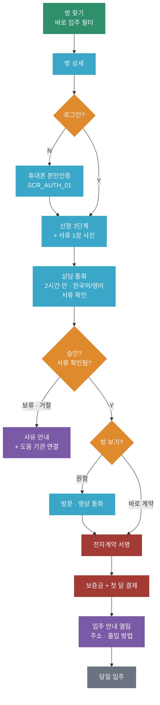

# IA · 유저 플로우 — Poom (품)

> 문서 세트: [목차](common_Index.md) · 기획: [브리프](owner_Brief.md) · [요구사항](planner_Requirements.md) · [정책](planner_Policy.md) · **IA·플로우** · [화면 설계](designer_Storyboard.md) · [데이터·API](developer_Data_API.md) · [기술·비기능](developer_Tech_NFR.md) · 사업·운영: [Business Model](planner_Monetization.md) · [운영 콘솔](planner_Admin.md) · [로그·지표](planner_Analytics.md) · [QA·출시](tester_Release.md) · [운영](operator_Operations.md) · [사업화·법무](owner_Legal.md) · [needFix](common_needFix.md)

> **문서 정보**

| 문서 번호 | 버전 | 상태 | 책임자 | 협업 | 최종 수정 | 관련 문서 |
|---|---|---|---|---|---|---|
| `D04-IA` | v0.6 | `Draft` | PM | UI 디자이너 · 프론트엔드 개발자 | 2026-11-26 | [화면 설계](designer_Storyboard.md) |

**변경 이력**

| 버전 | 날짜 | 변경 내용 | 사유 | 결정자 | 영향 범위 |
|---|---|---|---|---|---|
| v0.8 | 2026-11-27 | 공지사항 화면, 메뉴 순서(커뮤니티 맨 끝), 아래 탭 = 홈 · 방 찾기 · 내 집 · 공지 · 커뮤니티 | `REQ_046` ~ `048` · `POL_MENU_01` | PM | 메뉴 · 탭바 · 홈 |
| v0.7 | 2026-11-27 | 커뮤니티 메뉴 · 묻고 답하기 화면, 아래 탭 5개 | `REQ_041` ~ `044` | PM | 메뉴 · 탭바 |
| v0.6 | 2026-11-27 | 검색 · 지도 · 관심 방 · 안내 · 제휴 화면 | 원하는 지역 · 학교 · 직장 근처로 방을 찾게 함 | PM | 홈 · 방 찾기 · 내 집 · 소식 |
| v0.5 | 2026-11-26 | 의견 · 신고 · 내 신고 화면 | 민원 · 오류를 끝까지 처리하고 개선 방향을 정하기 위함 | PM | 전 화면 |
| v0.4 | 2026-11-26 | 가족 수 분기 추가 | `POL_ROOM` | PM | 방 찾기 · 신청 |
| v0.3 | 2026-11-26 | 서류를 신청 단계로 (입주 전), 서류 분기 추가 | `POL_HOUSE_02` | PM | 신청 · 계약 |
| v0.2 | 2026-11-26 | 상담 2시간 · 방 보기 선택 · 당일 입주, 언어 전환 · 외국인 분기 | `POL_HOUSE_04` · `POL_LANG_01` | PM | 라우팅 |
| v0.1 | 2026-11-26 | 첫 초안 | 서비스 기획 시작 | PM | 전체 |

---

## 1. 목적
서비스 뼈대와 화면 이동 경로. 프론트엔드 라우팅 기준.

## 2. IA (메뉴 트리)
| 1Depth (하단 탭) | 2Depth | 화면 ID | 경로 |
|---|---|---|---|
| 홈 | **검색창** · 추천 검색 칩 · 바로 입주 가능한 방 · 지역별 · 학교별 둘러보기 · 이용 방법 3단계 · 긴급 도움 | `SCR_HOME_01` | `/` |
|  | 검색 (추천 목록 · 최근 검색어) | `SCR_SEARCH_01` | 홈 · 방 찾기 검색창 |
| 방 찾기 | 목록 (필터) | `SCR_ROOM_LIST_01` | `/rooms?q=…` |
|  | 지도 (목록과 나란히 / 휴대폰은 전환) | `SCR_MAP_01` | `/rooms?view=map` |
|  | 방 상세 | `SCR_ROOM_DETAIL_01` | `/rooms/:id` |
|  | 신청 1 · 2 · 3단계 | `SCR_APPLY_01` ~ `03` | `/apply/:roomId/1~3` |
|  | 신청 완료 | `SCR_APPLY_DONE_01` | `/apply/done` |
| 내 집 (EN: My Home) | 신청 상태 · 방 보기 예약 | `SCR_MY_01` · `SCR_TOUR_01` | `/my` · `/my/tour` |
|  | 계약서 서명 | `SCR_CONTRACT_01` | `/my/contract` |
|  | 결제 | `SCR_PAY_01` | `/my/pay` |
|  | 입주 안내 | `SCR_MOVEIN_01` | `/my/movein` |
|  | 하우스 (공지 · 수리 요청) | `SCR_HOUSE_01` | `/my/house` |
|  | 돌봄 품앗이 | `SCR_CARE_01` | `/my/care` |
|  | 관심 방 · 빈방 알림 | `SCR_MY_SAVED_01` | `/my/saved` |
| 소식 | 공공임대 · 한부모 공고 | `SCR_NOTICE_01` | `/notice` |
| 공지 | 공지사항 목록 (📌 중요 맨 위) | `SCR_ANNOUNCE_01` | `/notices` |
|  | 공지 보기 | `SCR_ANNOUNCE_02` | `/notices/:id` |
| 커뮤니티 (맨 끝) | 묻고 답하기 목록 · 검색 · 주제 | `SCR_COMMUNITY_01` | `/community` |
|  | 질문 · 답변 보기 · 답변 쓰기 | `SCR_COMMUNITY_02` | `/community/:id` |
|  | 질문하기 | `SCR_COMMUNITY_03` | `/community/ask` |
|  | 이용 방법 · 자주 묻는 질문 · 입주 후기 | `SCR_GUIDE_01` | `/guide` |
|  | 집 빌려주실 분 (제휴 문의) | `SCR_PARTNER_01` | `/partner` |
| (공통) | 본인인증 | `SCR_AUTH_01` | `/auth` |
|  | 긴급 도움 (시트) | `SCR_HELP_01` | 모든 화면 하단 |
|  | 언어 전환 (한국어 · English) | `SCR_LANG_01` | 모든 화면 오른쪽 위 · 영어는 `/en/…` |
|  | 약관 · 개인정보 · 사업자 정보 | `SCR_LEGAL_01` | `/legal/*` |
|  | 의견 · 신고 (시트) | `SCR_REPORT_01` | 모든 화면 오른쪽 아래 [💬] |
| 내 집 | 내 신고 · 답장 | `SCR_MY_REPORT_01` | `/my/reports` |

## 3. 접근 권한
| 화면 | 비로그인 | 본인인증 | 승인된 신청자 | 입주자 | 운영 매니저 |
|---|---|---|---|---|---|
| 홈 · 방 찾기 · 소식 · 긴급 도움 | ✅ | ✅ | ✅ | ✅ | ✅ |
| 신청 | → 본인인증 | ✅ | ✅ | — | — |
| 계약 · 결제 | ❌ | ❌ | ✅ | ✅ | 조회 |
| 입주 안내 (주소) · 하우스 · 돌봄 | ❌ | ❌ | ❌ | ✅ | ✅ |

## 4. 핵심 플로우 — 방 보기부터 입주까지

## 5. 분기
| 상황 | 처리 |
|---|---|
| 비로그인으로 신청 누름 | 본인인증 → 그 방 신청 1단계로 복귀 |
| 신청 중 이탈 | 입력값 기기에 임시 저장, 다시 들어오면 이어서 |
| 신청 때 서류를 못 올림 | 신청은 접수, 내 집에 [서류 올리기] 표시. 승인돼도 서류 확인 전까지 계약서 잠금 |
| 서류가 흐리거나 다른 서류 | 운영 매니저 [재요청] → 문자 · 내 집에 다시 올리기 |
| 검색 결과 0건 | 조건 넓히기 제안 · 가까운 지역 추천 · [생기면 알림] (`REQ_036`) |
| 관심 방 · 빈방 알림 누름 (비로그인) | 본인인증 → 원래 화면에서 저장 완료 |
| 가족 수보다 작은 방 신청 | `ROOM_422` → 같은 하우스 · 근처의 맞는 방 추천 |
| 자녀 5명 이상 | 신청 대신 상담 요청 → 공공임대 연결 (`POL_ROOM_05`) |
| 신청 사이 방이 다른 사람에게 계약됨 | "방금 계약된 방이에요" + 같은 하우스 · 근처 빈방 추천 |
| 승인 후 72시간 안 계약 안 함 | 방 잡아 두기 해제, 문자 안내 |
| 결제 실패 | 결제 화면 유지 + 다른 수단 안내, 방은 24시간 유지 |
| 세션 만료 | 문자 코드 재로그인 → 원래 화면 |
| 서류 · 계약 · 결제 · 입주 안내 화면에서 신고 | 화면 사진 칸 숨김, 나머지는 같음 (`POL_REPORT_04`) |
| 🛡 안전 신고 | 보내기 전 112 안내 시트 → 접수 → 운영 매니저 · 대표 즉시 알림 |
| 문자 링크로 바로 진입 (계약 · 결제) | 로그인 확인 → 해당 화면 |
| 언어 전환 | 같은 화면 · 입력값 유지한 채 `/` ↔ `/en/` 경로만 바뀜. 문자 링크는 사용자 언어로 |
| 본인 명의 휴대폰 없는 외국인 | 문자 코드로 신청 → "본인 확인 필요" → 상담 통화 때 외국인등록증 확인 (`POL_MEMBER_04`) |
